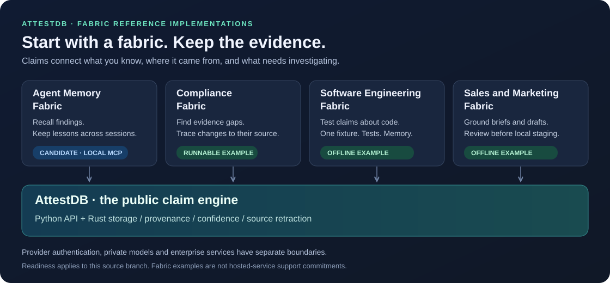

# AttestDB

An embedded database for claims with sources, confidence scores and timestamps.
The Python API uses a Rust storage engine backed by LMDB.



This is the **0.2.1 release candidate**. Brain features below require this
candidate; they are not a claim about older published packages.

Choose an application path:

| Priority | Reference implementation | Purpose | Readiness |
| --- | --- | --- | --- |
| 1 | [Brain](#local-agent-memory) | Persistent findings, failed approaches and session outcomes | Tested release candidate |
| 2 | [Attest Swarm](#offline-swarm-example) | One synthetic builder, real tests, Brain memory and replay | Runnable offline example |
| 3 | [Compliance evidence](#compliance-evidence-example) | Find uncovered obligations; reopen gaps after evidence withdrawal | Runnable synthetic example |
| 4 | [AutoFunnel](#offline-autofunnel-example) | Sourced account briefs, drafts and approval-gated local staging | Runnable offline example |
| Later | [Research workbench](docs/reference-architectures.md#proposed-portfolio) | Investigate unanswered questions and conflicting sources | Proposed |
| Later | [Support and incidents](docs/reference-architectures.md#proposed-portfolio) | Track diagnostic evidence and verified resolutions | Proposed |
| Later | [Supplier assurance](docs/reference-architectures.md#proposed-portfolio) | Review missing or stale supplier evidence | Proposed |

See the [architecture and delivery plan](docs/reference-architectures.md) for
boundaries, acceptance gates and what each label means. The planned references
are not included applications or supported hosted services.

```bash
pip install attestdb
```

```python
from attestdb import AttestDB

db = AttestDB("example.attest", embedding_dim=None)
try:
    db.ingest(
        subject=("service-a", "service"),
        predicate=("depends_on", "relates_to"),
        object=("cache", "service"),
        provenance={"source_id": "deployment-1", "source_type": "manual"},
        confidence=0.9,
    )
    assert len(db.claims_for("service-a")) == 1

    result = db.retract("deployment-1", reason="Superseded deployment record")
    assert result.retracted_count == 1
finally:
    db.close()
```

## Local agent memory

Install the MCP extra, then configure your coding client:

```bash
pip install 'attestdb[mcp]'
attest brain install --tool claude
# Or: attest brain install --tool codex
```

Restart the client. Ask it to call
`attest_learned("auth.py", "Check session expiry before accepting a token", "tip")`,
then `attest_check_file("auth.py")`. Findings remain after the MCP server restarts.
`attest_negative_result`, `attest_get_prior_approaches` and `attest_session_end`
store failed approaches, recall topics and record reported outcomes.

Storage is local and requires no model API key. Topic recall is lexical; file
recall is exact. Records are agent-reported evidence, not independently verified
truth. The public installer adds MCP configuration without lifecycle hooks or
semantic recall, and preserves other client settings.

## Offline Swarm example

From a source checkout with the candidate AttestDB package installed:

```bash
python examples/swarm_reference.py --run-dir /tmp/attest-swarm-demo --db /tmp/swarm-memory.attest
python examples/swarm_reference.py --run-dir /tmp/attest-swarm-demo --replay
```

A synthetic builder repairs a tiny fixture; real subprocess tests check the result,
then public Brain memory stores the evidence. One builder attempt is allowed per
run directory. Failed checks or an explicit review policy require human review.
This example makes no model calls. See the [walkthrough and limits](docs/swarm-reference.md).

## Offline AutoFunnel example

From a source checkout with the candidate AttestDB package installed:

```bash
python examples/autofunnel_reference.py
```

Synthetic account and product facts become a cited brief and a template draft.
Only an unchanged, approved draft with explicit demo consent and no suppression
can enter the local outbox. Withdrawing required evidence blocks further staging.
No messages are sent and no model calls are made. See the
[walkthrough and boundaries](docs/autofunnel-reference.md).

## Compliance evidence example

From a source checkout with AttestDB installed:

```bash
python examples/compliance_evidence.py
```

The example starts with two uncovered, invented obligations. Adding synthetic
evidence covers one; withdrawing its source reopens that gap. It demonstrates
evidence-link coverage, not certification, legal compliance or evidence acceptance.

The open source package contains the claim engine and selected basic connectors.
Proprietary models, model training and evaluation assets, enterprise connectors,
plugins and hosted services are outside this release.

For a source checkout, run the Python tests with `pytest tests/` and the storage
engine tests with `cargo test --manifest-path rust/Cargo.toml --all`.

Python 3.11 and 3.12 are the release test targets. If a matching native wheel is
unavailable, building `attest-py` from source requires a Rust toolchain.

CI and release validation run on private runners. See [release validation](RELEASE_POLICY.md).

Licensed under [Apache-2.0](LICENSE).
