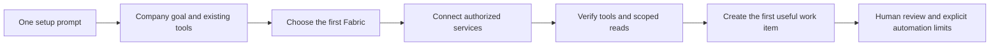

# AutoCompany: put your company on Fabric

Start with the agent client you already use. Give Dot, Claude Code, Codex or
another capable client this prompt from a trusted Fabric source checkout:

> Help me set up my company on Fabric using the AutoCompany setup skill at
> `skills/autocompany-setup/SKILL.md`. Ask what my company does, which tools we
> already use, and which workflow I want to automate first. Reuse my existing
> accounts and help me connect the selected Fabric. Create the first useful work
> item, show what is connected and what still needs attention, and give me a simple
> way to resume. Start with a small budget and human review of proposed changes.

If the client cannot read local skill files, supply the skill through its
supported attachment or skill-import flow. There is no qualified Dot-specific
installer in this checkout. A public hosted setup link is a release deliverable,
not a URL to guess.

The target experience is one setup conversation followed by a working first
workflow. The current kit provides a portable skill and private workspace creator;
it does not provision every service, authenticate external accounts or start
unattended company operations by itself. The skill guides actual discovery and
verification using the user's client and available services.

The workspace is a private operational artifact. Keep it outside public source
repositories. The creator is idempotent for identical input, refuses differing
existing configuration and records connections as `not_checked`, with automation
paused. Existing connections are verified through actual tools before their state
changes. Creating a manifest is not proof that a company is running.

## Patterns informing the design

- [Paperclip company packages](https://github.com/paperclipai/companies) provide a
  company-creator skill that interviews users and scaffolds a company package.
- [Paperclip's skills store](https://github.com/paperclipai/paperclip/blob/master/docs/guides/agent-developer/skills-store.md)
  separates its catalog from the skills installed for a specific company.
- [gstack](https://github.com/garrytan/gstack) packages engineering work into
  role-specific skills and documents different host integration levels.
- [OpenClaw skills](https://docs.openclaw.ai/tools/skills) distinguish discovery,
  runtime readiness and visibility to the selected agent.
- [Agent Skills](https://agentskills.io/specification) defines the portable
  `SKILL.md` package structure used by this setup kit.

These are design references, not bundled dependencies or assertions of compatibility
with their runtimes. No third-party skill code is imported or executed by this kit.
