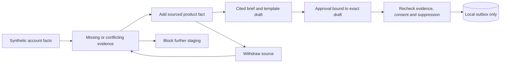

# Sales and Marketing Fabric

**Implementation: AutoFunnel — offline synthetic reference.**

A synthetic account brief demonstrates how missing evidence becomes an
investigation task, sourced facts become a draft, and human review gates local
staging. This example is written independently of the private AutoFunnel app. It
uses the public AttestDB API, invented account/product facts and `.invalid`
recipients. There are no model calls, subscriptions, API credentials or network
integrations. Provider cost is zero.

## Run from a source checkout

With the matching candidate AttestDB package installed:

```bash
python examples/autofunnel_reference.py
```

The example creates an ephemeral real database and prints each step:

1. An account priority exists; missing product evidence appears as a gap.
2. A synthetic product sheet supplies the required fact and closes the gap.
3. A template draft cites the claim IDs. Without approval, local staging is blocked.
4. A named synthetic reviewer approves that exact draft. Explicit demo consent
   and a clear suppression check permit a local outbox record. Delivery stays off.
5. Withdrawing the product source reopens the gap and blocks further staging,
   even with the earlier approval.



## Boundaries

- These facts and sources are invented. The template does not infer buyer intent,
  generate product promises or claim campaign effectiveness. Stored confidence
  is a fixture value, not a calibrated assessment of truth.
- Approval binds recipient, subject, body and claim IDs. Any change requires new
  review. The reviewer field is simulated identity, not authenticated approval.
- Demo consent is an explicit boolean supplied by the caller. The suppression
  list is also caller supplied and checked case-insensitively. These demonstrate
  gating behavior; they do not establish legal permission for actual outreach.
- Required facts must have one unambiguous text value among active claims.
  Retrieval is bounded at 100 claims per entity; excess evidence blocks drafting
  for investigation. The example has no source-freshness policy or semantic
  contradiction detector.
- A fresh draft is rebuilt before staging to catch changed or withdrawn evidence.
  This check and the outbox write are not atomic. Concurrent changes and source
  withdrawal do not automatically cancel historical outbox records. Production
  delivery would need transactional revalidation and queue invalidation.
- The local outbox records evidence and review metadata. It never sends email,
  posts content, calls a CRM, or records a fabricated delivery or conversion.
  Observed outcome remains `null`.

Tests use real LMDB, persist and reopen the outbox, and check evidence gaps,
withdrawal, conflicts, exact-draft approval, changed evidence, consent,
suppression and synthetic-recipient restrictions. No private CRM, advertising,
enrichment, email connectors or proprietary application code are included.

Authenticated review, durable permission sources, delivery idempotency, freshness,
privacy controls and an explicitly authorized delivery adapter require separate
implementation and tests before this can become a supported service.
