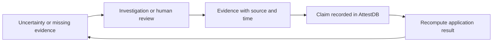
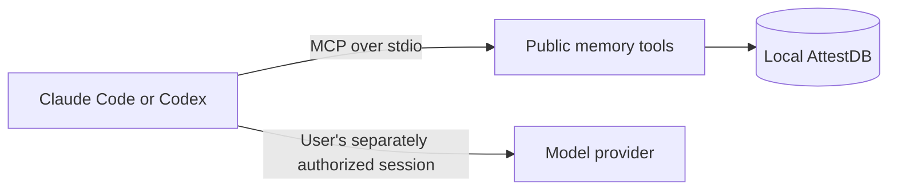
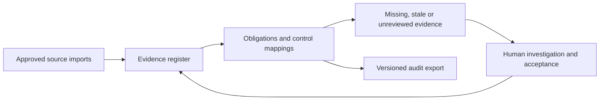
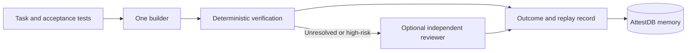
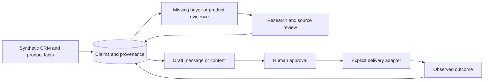

# Fabric reference implementations

Each Fabric reference implementation demonstrates an application domain on the
public claim engine. Brain, Attest Swarm and AutoFunnel identify the corresponding
implementations. Each reference must demonstrate
an uncertainty, the evidence needed to investigate it, an evidence update, and
the resulting change in what the application reports. A diagram is not a support
commitment. Readiness below refers to this source branch, not an available hosted service.

| Fabric reference implementation | Current public deliverable | Next acceptance gate |
| --- | --- | --- |
| Agent Memory Fabric (Brain) | Candidate MCP memory tools and client configuration | Independent review and release; installed-wheel tests have passed on private CI |
| Compliance Fabric | Synthetic runnable evidence-link example | Tested collection freshness, evidence review and coverage boundaries before a larger reference |
| Software Engineering Fabric (Attest Swarm) | Offline synthetic workflow with real tests, memory and replay | Provider adapter review and a separately budgeted single-agent comparison before live support |
| Sales and Marketing Fabric (AutoFunnel) | Synthetic brief, cited draft, approval checks and local outbox | Authenticated review, current permission sources and delivery-adapter review before any external delivery |

## Proposed portfolio

These are delivery priorities, not promises of supported services.

| Order | Fabric reference implementation | Purpose | Scope |
| --- | --- | --- | --- |
| 1 | Agent Memory Fabric (Brain) | Persistent findings and prior approaches for existing agents | Public candidate |
| 2 | Software Engineering Fabric (Attest Swarm) | Bounded coding, deterministic checks and recorded outcomes | Offline synthetic example |
| 3 | Compliance Fabric | Investigate missing or withdrawn obligation evidence | Synthetic coverage example |
| 4 | Sales and Marketing Fabric (AutoFunnel) | Sourced account briefs and approved outreach drafts | Offline synthetic example |
| Later | Research Fabric | Investigate unanswered questions and conflicting sources | Proposed |
| Later | Support and Incident Fabric | Reuse verified resolutions and investigate unresolved causes | Proposed |
| Later | Supplier Assurance Fabric | Review missing or stale evidence behind supplier decisions | Proposed |

## Shared application contract

Every reference should ship an installable example, synthetic fixtures, one
end-to-end test, an architecture diagram, a deployment boundary, a cost model,
and an explicit list of unimplemented or unqualified integrations. Imports must
work with only public distributions. User data and credentials are not demo fixtures.

## Agent Memory Fabric

Implementation: **Brain**, local memory for existing agent clients.

The host agent reasons; memory tools store agent-reported findings and outcomes.
Topic recall is lexical, file recall is exact, and stored material is evidence to
check rather than instructions to execute. Installation must preserve other MCP
servers and settings. The public installer does not install lifecycle hooks or
provide semantic recall. Memory-tool storage does not require model credentials.

## Compliance Fabric

Investigate uncovered obligations.

The current [example](../examples/compliance_evidence.py) links two invented
obligations to synthetic evidence. Adding an evidence link closes one coverage
gap; withdrawing the source opens it again. It evaluates link coverage only.
It does not validate evidence quality, declare legal compliance, or grant certification.

The larger reference is planned around this flow:

Public scope should use invented policies and synthetic artifacts, file-based
imports, provenance, review records and reproducible exports. A multi-user portal,
authorization, encrypted archives, framework packs and enterprise collectors each
need their own public/private decision and tests; they are not implied by this demo.

## Software Engineering Fabric

Implementation: **Attest Swarm**, bounded coding with recorded evidence.

The [offline walkthrough](swarm-reference.md) runs one deterministic synthetic
builder, real acceptance checks, persisted public Brain memory and a replay log.
It has no provider adapter and spends no model credits. Its builder reservation
is per run directory; it does not implement an account-wide spending budget.

For a future live adapter, start with one builder and hard invocation/time limits. Escalate only on explicit
criteria. Local provider adapters should use officially supported authentication;
the selected billing mode must be visible and must not silently fall back to a
paid API or another account. Provider limits remain real limits.

Before calling this reference supported, compare single-agent and swarm runs on
the same pinned tasks. Record acceptance-test outcomes, invocations, elapsed time,
tokens when reported, authentication/billing mode and quota-limit stops. Unknown
usage is unknown, not zero. Set a small live-run budget before using subscriptions.
The existing private swarm code is not automatically approved for publication.

## Sales and Marketing Fabric

Implementation: **AutoFunnel**, sales and marketing drafts backed by evidence.

The [offline walkthrough](autofunnel-reference.md) builds a synthetic account brief
and a template draft from claim references. Tests enforce approval bound to the
exact draft, demo consent and suppression checks, and evidence revalidation before
local staging. Conflicting or withdrawn evidence requires investigation. There is
no external delivery adapter or model call; observed outcomes remain unknown.

Authenticated reviewers, real permission sources, freshness rules, transactional
queue invalidation and delivery integration are future gates. Private CRM,
advertising, enrichment and email connectors are not public by default.

## Delivery order and README promotion

1. Complete independent Brain release review; installed-wheel validation has passed.
2. Keep the compliance example small; add reviewed freshness and acceptance semantics next.
3. Review the independently written offline Swarm reference before adding a bounded live adapter.
4. Review the independently written synthetic Autofunnel reference before adding real integrations.

Use `planned`, `runnable example`, `validated reference`, and `supported service`
as distinct labels. A supported service additionally needs a named owner,
supported versions, deployment/upgrade instructions, recovery tests and a support
policy. Nothing on this page currently establishes a supported hosted service.
