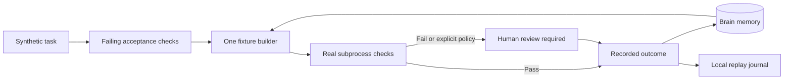

# Software Engineering Fabric

**Implementation: Attest Swarm — offline synthetic reference.**

This small reference demonstrates the application loop using only public AttestDB
and Brain APIs. It is written independently of the private Swarm application.
The builder is a deterministic fixture, not a coding model. No API credentials,
subscriptions, external services or model calls are used.

## Run from this source checkout

Install the matching candidate AttestDB wheel (including its native dependency),
then run with a new directory:

```bash
python examples/swarm_reference.py --run-dir /tmp/swarm-first --db /tmp/swarm-memory.attest
python examples/swarm_reference.py --run-dir /tmp/swarm-first --replay
python examples/swarm_reference.py --run-dir /tmp/swarm-second --db /tmp/swarm-memory.attest
```

The second run recalls the first outcome from the same persistent Brain database.
This reference depends on the candidate public memory API; it is not a promise
that the currently published package contains that API.



The task is to trim whitespace from a display name and use `Anonymous` for an
empty name. Acceptance checks cover padded, empty, whitespace-only, unchanged and
Unicode names. The journal records the failing baseline, attempt reservation,
verification result, source and acceptance-code hashes, and memory claim ID.
Brain records remain agent-reported; passing these checks proves only this fixture's
assertions, not general code correctness. No confidence calibration is implied.

Use `--require-review` to require a separate human review even when checks pass.
The process exits 2 when review is required; failed checks never trigger another
builder. This reference records review escalation; it does not implement reviewer
approval or automatically deliver code. Replay reads records without executing work.

## Boundaries and recovery

- A directory is reserved exclusively before work starts. Reusing that directory,
  including after a crash, fails. An interrupted run is for inspection, not retry.
- One builder call is permitted per directory. Creating another directory starts
  another run. This is not an account-wide or tamper-resistant budget.
- Acceptance subprocesses have a five-second timeout each. The trusted fixture
  builder itself has no execution deadline. A live adapter needs its own process
  supervision, authentication checks, quota policy and explicit attempt cap.
- The journal flushes and fsyncs each event. This is a local diagnostic log, not a
  transactional or tamper-proof audit ledger. Brain and the journal are separate
  writes; a crash between them can leave partial evidence. Inspect both; do not
  automatically repeat the builder. No power-loss durability guarantee is made.
- Python isolated mode is not a security sandbox. Run only the supplied trusted
  fixture. Do not execute untrusted generated code on a host with credentials.
- Verification output is represented by exit status or timeout; source hashes
  identify the checked fixture. This is not a full transcript or deterministic
  re-execution system.

Tests use real LMDB persistence and real subprocess checks. They cover recall after
reopening, replay, passing and failing checks, explicit review, builder errors,
repeated and simultaneous reservations, and verifier timeouts.

A live subscription adapter and a comparison against a single-agent baseline are
separate future gates. Do not describe this fixture as a supported coding service
or a measured productivity improvement.
